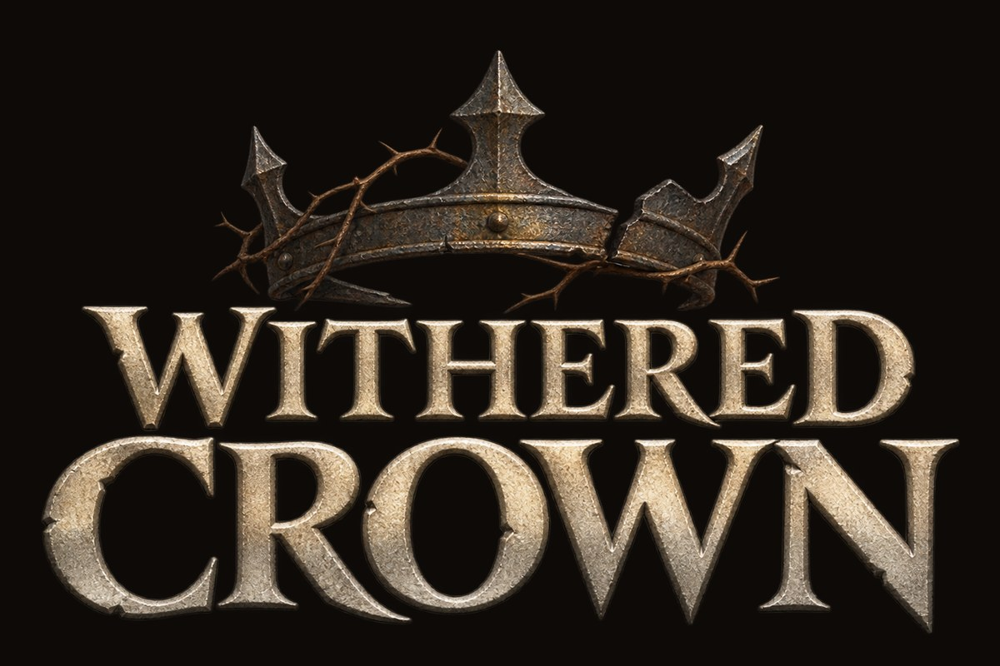
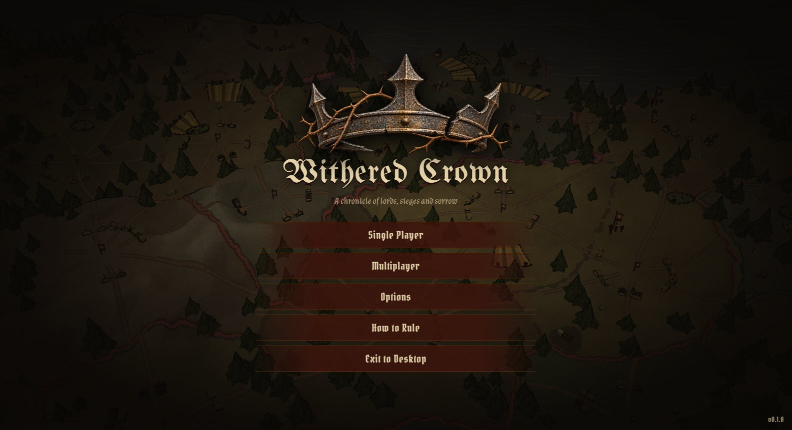
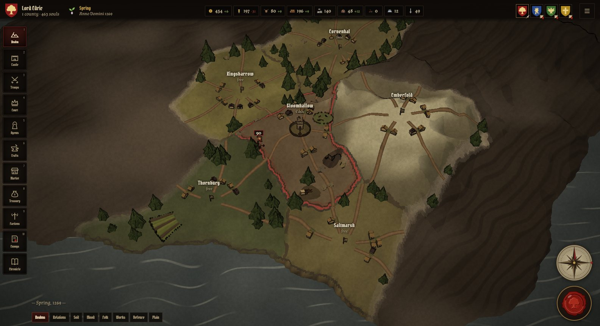
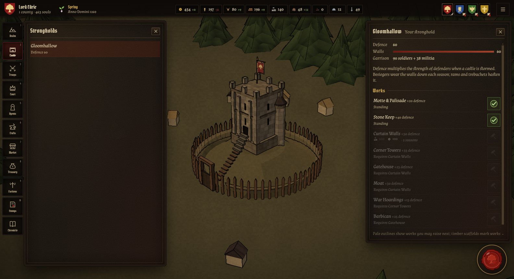
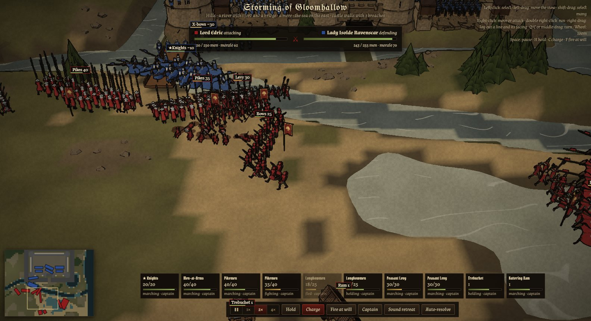

<p align="center">
  
</p>

<p align="center"><i>A chronicle of lords, sieges and sorrow.</i></p>

<h3 align="center"><a href="https://github.com/withered-crown/play/releases/latest">Download the latest version</a></h3>
<p align="center">Windows · macOS · Linux</p>

<p align="center">
  
  
  
  
</p>

Rule your counties and their folk through the seasons. Keep a court of vassals, forge arms, send caravans and agents abroad. Lead your hosts on the battlefield yourself and storm castles. Then claim the Withered Crown and hold it, while every other lord has cause to strike.

## Play together

One lord hosts a realm and gets a six-letter **invite code**; friends choose *Join a Realm* and enter it, or open an invitation link. No port forwarding, no account. A realm can be sealed with a password, and its host can stop and resume it later: the lords find their seats again.

Battles are fought, not rolled: each lord commands his own host on the field, or leaves it to his captains. Only allies, and lords with a spy nearby, may watch. What you learn of the rest of the realm depends on what your people can see; from further off come only rumours, and rumours lie.

Everyone at a table must play the same version. The game keeps itself up to date (see below), so this is rarely a problem for long.

## Installing

Take the file for your system from the [latest release](https://github.com/withered-crown/play/releases/latest).

| System | File | Notes |
|---|---|---|
| Windows 10 and 11 | `Withered-Crown-Setup-<version>.exe` | Windows may warn about an unrecognised app: choose **More info**, then **Run anyway**. |
| macOS 11 and later | `Withered-Crown-<version>-mac-<arch>.dmg` | `arm64` for Apple silicon, `x64` for Intel Macs. The first time, right-click the app and choose **Open**, or allow it in *System Settings → Privacy & Security*. |
| Linux | `Withered-Crown-<version>-x86_64.AppImage` | Make it executable (`chmod +x`), then run it. |

The game isn't code-signed yet, which is why Windows and macOS warn on first launch.

## Updates

On Windows and Linux, the game checks for a new version when it starts, downloads it in the background, and offers *Restart to update* on the title screen. It never interrupts a game: an update you leave waiting is installed when you close Withered Crown.

On macOS, the title screen tells you when a new version is out and opens this page; download it and replace the app.

The version you have is shown in the corner of the title screen and at the foot of the in-game menu.

## When friends can't connect

Most home networks let the game connect directly. Some, such as offices, universities, mobile hotspots and some internet providers, block direct connections, and the game says so: *"Could not reach the host. They may be offline, or their network blocks direct connections; a relay (TURN) server may be needed."*

A relay can be added in a file named `config.json` in the game's data folder:

- Windows: `%APPDATA%\Withered Crown`
- macOS: `~/Library/Application Support/Withered Crown`
- Linux: `~/.config/Withered Crown`

```json
{"iceServers": [
  {"urls": "stun:stun.l.google.com:19302"},
  {"urls": "turn:turn.example.org:3478", "username": "your-user", "credential": "your-secret"}
]}
```

Hosted TURN services (Metered, Cloudflare and others) offer free allowances large enough for a group of friends. Restart the game after changing the file. When a link goes through the relay, the realm lobby shows **Relayed** instead of **Direct connection**.

## Your saves

Campaigns, hosted realms and your identity at the table are kept as files in that same data folder, under `saves`, `realms` and `local`. Uninstalling the game leaves them in place.
